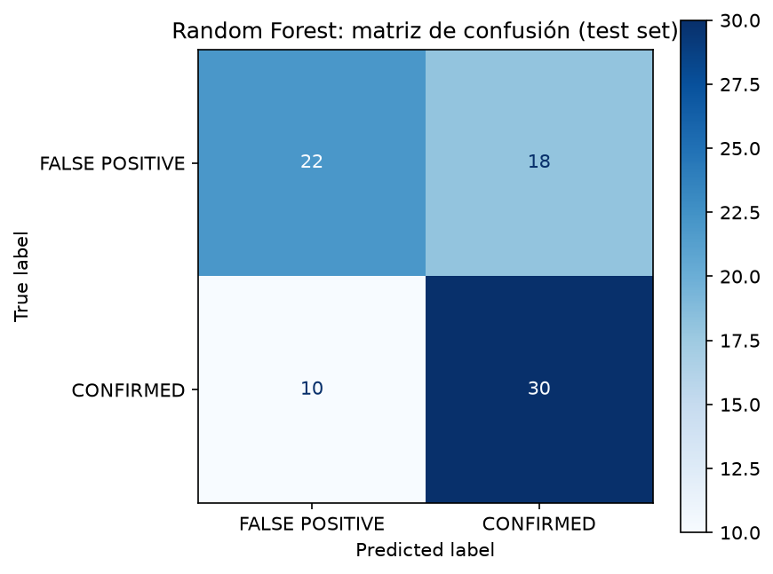
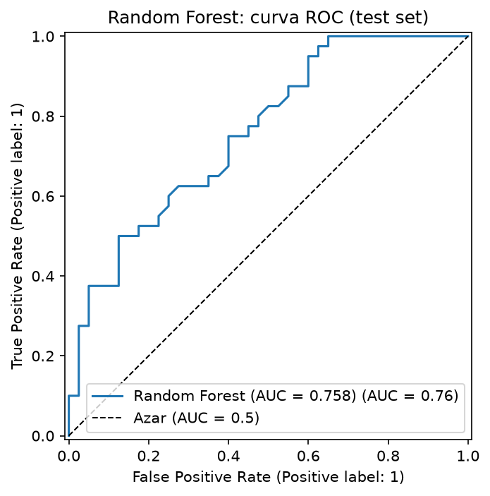
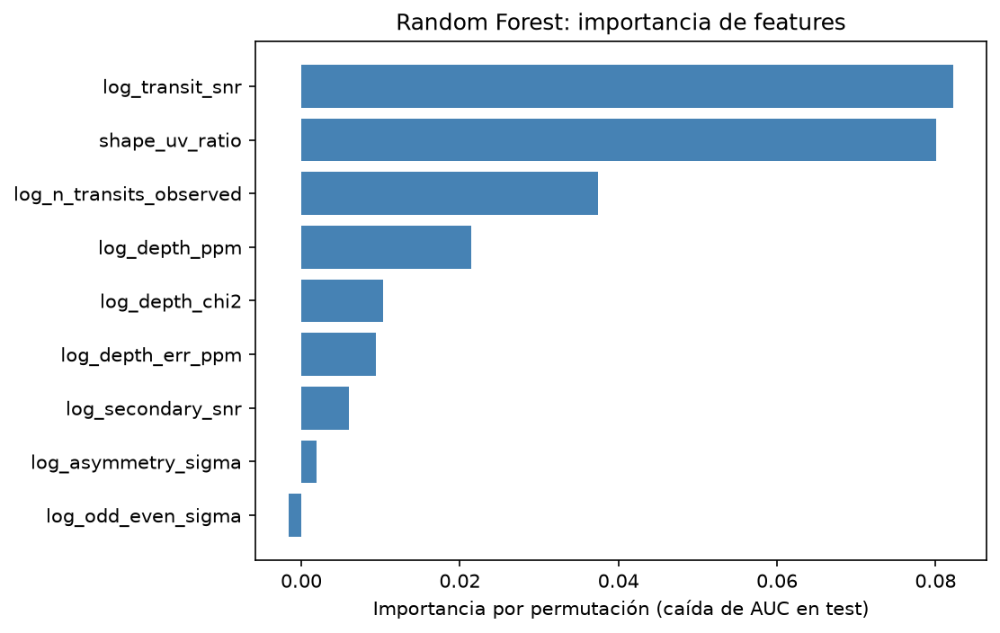

# exoplanet-transit-classifier

**Vetting Kepler planet candidates (CONFIRMED vs FALSE POSITIVE) from folded light-curve features, with leakage-aware, star-grouped validation.**


## Overview

This project downloads real light curves from NASA's **Kepler** mission (from MAST, through
[lightkurve](https://docs.lightkurve.org/)) and the **KOI cumulative catalog** from the
NASA Exoplanet Archive. For every Kepler Object of Interest (KOI) it folds the light curve on the
catalog ephemeris, measures the shape of the dip, and trains a Random Forest to tell
`CONFIRMED` planets from `FALSE POSITIVE`s.

**What this is, and what it is not.** This is a **candidate-vetting** project, not a
from-scratch discovery project. The candidate signals and their ephemerides (period, epoch, duration)
were already found by the Kepler pipeline; the model only decides whether a given candidate looks
like a planet or like an impostor (typically an eclipsing binary). Also note that NASA's labels are
partly derived from tests similar to the features used here (e.g. odd/even depth, secondary eclipse,
transit shape), so **the model partly reproduces NASA's own vetting** rather than providing an
independent verdict.

## Results

### Evolution v1 → v2 → v3

All numbers are ROC-AUC (mean ± std over 5 folds × 5 repeats = 25 folds), Random Forest, taken from
`docs/comparison_v1_v2.csv` and `docs/comparison_v2_v3.csv`. In v1/v2 each row is one star, so
stratified folds are automatically star-grouped. v3 has one row per KOI and uses `StratifiedGroupKFold`
grouped by `kepid`.

| Version | Rows | Features | CV AUC | What changed |
|---|---|---|---|---|
| v1 | 399 stars | 11, from BLS | 0.715 ± 0.042 | Baseline: BLS period search, detrend window of 1001 points (~20 d), raw `snr` / `power`. |
| v2 | 399 stars | 12, from BLS | 0.774 ± 0.051 | Detrend window cut to 101 points (~2.1 d); `log10(1+x)` on `snr` / `power`; added `duration_period_ratio`. |
| v2 (on v3 rows) | 489 KOIs | same 12 | 0.788 ± 0.048 | Same v2 features assigned to each KOI of the star, evaluated with the v3 protocol (star-grouped), for a paired comparison. |
| **v3** | **489 KOIs** | **9, folded on the catalog ephemeris** | **0.926 ± 0.025** | One row per KOI; fold with catalog period/epoch instead of BLS; features describe the transit shape and its consistency. |

Notes for reading the table honestly:

- The v1 → v2 gain (+0.06) is about one standard deviation across folds. We do not claim it is
  statistically solid.
- Logistic regression did **not** improve from v1 to v2 (0.720 ± 0.038 → 0.660 ± 0.045); see
  `docs/comparison_v1_v2.csv`.
- The v2 → v3 jump (0.788 → 0.926) is the only large effect in the project. Adding the 12 v2 features on top of the
  9 v3 features gives 0.931 ± 0.025, i.e. no real gain over v3 alone (`docs/comparison_v2_v3.csv`).

### Final model (Random Forest, 9 features, 489 KOIs in 394 stars; 282 CONFIRMED / 207 FALSE POSITIVE)

Output of the last run of `python src/train_model.py`.

| Metric | Star-grouped CV, 5×5 (mean ± std) | Held-out test (97 KOIs, 79 stars) |
|---|---|---|
| Accuracy | 0.856 ± 0.032 | 0.794 |
| Precision | 0.870 ± 0.033 | 0.846 |
| Recall | 0.885 ± 0.044 | 0.786 |
| F1 | 0.876 ± 0.028 | 0.815 |
| ROC-AUC | 0.926 ± 0.025 | 0.852 |

**Why the test column is lower.** Both are valid estimates of the same thing, but they are not equally
reliable. The CV averages 25 train/test splits over all 489 KOIs; the test column is a *single* split
of 97 KOIs, so each misclassified KOI moves accuracy by about one point (20 of the 97 were
misclassified), and the split's AUC is only one draw from a distribution whose CV standard deviation
is 0.025. We report the CV as the main result, and we report the held-out test because the figures and
`data/misclassified.csv` come from it. The test split is grouped by `kepid`, so no star is in both
train and test.

| Confusion matrix (held-out test) | ROC curve (held-out test) |
|---|---|
|  |  |

**Permutation importance** (drop in AUC on the held-out test when a feature is shuffled). The most useful
features are `log_transit_snr` (0.082) and `shape_uv_ratio` (0.080); `log_odd_even_sigma` is slightly
negative (−0.002), i.e. it contributes nothing on this test split.



### Negative controls

To check that the 0.926 is not an artifact of the pipeline, `src/negative_controls.py` repeats the
same 25 star-grouped folds under conditions where there should be little or no signal
(`docs/negative_controls.csv`).

| Control | What is done | ROC-AUC |
|---|---|---|
| Reference | Full v3 (9 features) | 0.926 ± 0.025 |
| Shuffled labels | Labels permuted in the training fold only (5 seeds, 125 folds) | 0.503 ± 0.092 |
| Random ephemeris | Features recomputed with a random period and epoch (3 seeds) | 0.637 / 0.654 / 0.663 |
| Random ephemeris, shape features only | Same, using only the 5 shape features | 0.568 / 0.606 / 0.625 |
| Shape and consistency only | 5 features, **without** transit count or SNR | 0.869 ± 0.037 |
| Same, without `shape_uv_ratio` | 4 features | 0.758 ± 0.045 |

Interpretation:

- **Shuffled labels → ~0.50 (chance).** The pipeline does not leak the labels through the evaluation.
- **Random ephemeris → ~0.65.** It is above chance, so the control is not perfectly clean. We attribute it to
  noise level and star variability rather than to a transit: in these runs the features that
  lose the most AUC when permuted are `log_depth_chi2` (0.049) and `log_depth_err_ppm` (0.044). This is our
  interpretation; we did not run a separate experiment to prove it.
- **Shape and consistency only → ~0.87.** Most of the performance survives without knowing the number
  of transits or the SNR. Removing `shape_uv_ratio` drops it to ~0.76, so the U/V shape is the single most
  informative feature.

## How it works

*(For readers with a technical background but no astrophysics.)*

**Transit.** When a planet passes in front of its star, the star's brightness dips slightly and
periodically. Kepler measured the brightness of ~150,000 stars every ~29.4 minutes (long cadence).

**Folding the curve.** If a signal repeats every *P* days, you can stack all the cycles on top of each other:
for each point compute its time since the nearest transit center, `(t − t0 + P/2) mod P − P/2`. The noise averages
out and the dip becomes visible. In v3 the period `P`, the epoch `t0`, and the duration `D` come from the KOI catalog
(`koi_period`, `koi_time0bk`, `koi_duration`).

**U vs V.** A planet is a small dark disk crossing the star: the dip has a flat-ish bottom (a "U", slightly rounded
by limb darkening). An eclipsing binary, especially a grazing one, blocks light gradually and gives a pointed
"V", and is often much deeper (a planet blocking ~8 % of its star is implausible). See the notebook
`notebooks/exoplanet_classifier_demo.ipynb` for three folded examples.

Pipeline per star (`src/koi_features.py`):

1. Mask the transits of **all** KOIs of the star (with margin), detrend with a Savitzky–Golay filter that ignores the masked points
   (window of 101 points ~2.1 d, enlarged if a transit is very long), normalize, and sigma-clip at 5σ (inside transits, only upward outliers are clipped).
2. For each KOI, exclude the transits of the *other* KOIs of the star and compute these features (all errors use
   a robust out-of-transit sigma from the MAD):

| Feature | What it measures |
|---|---|
| `log_depth_ppm` | Depth: out-of-transit median minus in-transit median (signed, log-scaled). |
| `log_depth_err_ppm` | Uncertainty of that depth. |
| `log_transit_snr` | Local SNR: depth / depth uncertainty (not the BLS SNR). |
| `log_n_transits_observed` | Number of transits with real data (at least half the expected points). |
| `log_odd_even_sigma` | Difference between odd and even transit depths, in sigmas. Eclipsing binaries at twice the real period show different odd and even dips. |
| `log_secondary_snr` | Depth at phase 0.5 (secondary eclipse), in sigmas. Planets rarely show one in Kepler data. |
| `log_asymmetry_sigma` | Difference between the ingress half and the egress half of the transit, in sigmas. |
| `shape_uv_ratio` | Depth of the central third divided by the mean depth. ~1.0 for a box, ~1.1–1.3 for a planet with limb darkening, ~1.7 for a triangle ("V"). `NaN` when the transit SNR is below 5. |
| `log_depth_chi2` | Reduced χ² of the individual transit depths: are all the transits the same depth? |

**Avoiding information leakage.** The catalog's `koi_*` columns are outputs of NASA's own
pipeline, so using them as features would let the model read the answer.

- The catalog is used **only** to fold and mask (`EPHEMERIS_COLUMNS`). No `koi_*` column is a feature; this is
  asserted when `koi_features.py` is imported (`_assert_no_leakage`) and in `tests/test_koi_features.py`.
- A star can have several KOIs, and they are correlated. All evaluation (CV and test) is grouped by `kepid`, so
  a star is never in train and test at the same time.
- The median imputer is inside the `Pipeline`, so it is fitted only on each fold's training data.
- Negative controls (above) check the whole pipeline.

## Lessons learned

**Detrend window and BLS (v1 → v2).** The first dataset ran BLS on curves detrended with a long window
(1001 points, ~20 d). In `docs/bls_diagnostic.csv`, the fraction of stars whose detected duration sits at the cap
of the search grid (`frac_at_cap`) was 0.49 at the long window with a 0.3 d cap and 0.11 at 101 points. Our reading
is that a long window leaves slow stellar variability in the curve and BLS fits *that* instead of a transit. We
cut the window to 101 points (~2.1 d). The diagnostic also compared BLS duration caps of 0.15 d and 0.3 d;
the cap sits at 0.3 d (the `find_transits` default) and the 101-point window had the lowest `frac_at_cap` with it (0.11).

**Small AUC differences with 100 stars are noise.** The diagnostic used 100 stars, and its fold-to-fold
standard deviation of AUC is 0.08–0.12. The AUC of the windows ranged from 0.70 to 0.76 (`docs/bls_diagnostic_fine.csv`:
0.740 at 51 points, 0.700 at 75, 0.758 at 101, 0.741 at 151), which is not a monotone trend and is well inside the
noise. So the choice of 101 rests mainly on `frac_at_cap` and on its being a reasonable physical scale (~2 d, longer than typical transits),
**not** on it being the best AUC. This is also why we moved from a diagnostic on 100 stars to a
comparison with 25 paired, star-grouped folds over the whole dataset.

**Why we fold with the catalog ephemeris (v3).** After the v2 fixes the AUC was still 0.77–0.79. The
logistic regression was weak (0.66–0.69), which suggests (our reading) that the features, not the model, were the limit:
BLS finds *a* period, not always *the* planet's, and its SNR / power are heavy-tailed summaries that say little
about the shape. Because the task is vetting (the candidate is already given), it is legitimate to use the catalog ephemeris to fold
the curve, as long as the ephemeris is not itself a feature. Folding on a known period lets us measure
the shape of the dip directly, and the AUC went to 0.926. At the same time, one row per KOI (instead of per
star) required grouped validation, since a star can have several KOIs.

**Check the result before celebrating it.** A jump from 0.79 to 0.93 deserved suspicion, hence the negative
controls. They showed there is no label leakage (0.50), but they also showed that the random-ephemeris AUC is
~0.65 (not 0.50) and that the model depends strongly on one feature (`shape_uv_ratio`).

## Limitations

- **Only 4 Kepler quarters** per star are used (the first 4, out of 17), so many transits are missing.
- **Long cadence (~29 minutes).** Short transits are sampled by few points. `shape_uv_ratio` is `NaN` for short or low-SNR transits
  (SNR < 5), and the median imputer fills it in, which hides that the shape was not measurable.
- **The folds reuse the same stars** in each of the 5 repeats, so the 25 folds are not independent and
  the reported standard deviations are optimistic.
- **`log_n_transits_observed` is almost a function of the catalog period** (with a fixed observation window,
  the number of transits is roughly window / period), so it carries period information indirectly. We did not test how much of its importance comes from that.
- **The model partly reproduces NASA's vetting.** The labels come from tests similar to these features, so a high AUC
  does not mean the model finds planets on its own.
- **Held-out test is small** (97 KOIs); see the discussion above.
- **The saved model (`data/model.pkl`) was trained on the 80 % split only**, not on all the data, so
  that the notebook and figures describe the model that was evaluated.
- Only KOIs with a catalog ephemeris and a cached light curve are included; CANDIDATE KOIs are excluded.

## Installation

Python 3.14 was used for the reported results. Internet access is required to download the light curves and the catalog.

```bash
git clone https://github.com/Polacco/exoplanet-transit-classifier.git
cd exoplanet-transit-classifier
python -m venv venv

source venv/bin/activate          # bash / zsh
source venv/bin/activate.fish     # fish

pip install -r requirements.txt
```

`data/` is in `.gitignore` and is **not versioned**: light curves, catalogs, the feature datasets and
`data/model.pkl` must be regenerated locally with the commands below.

## Usage

Run these in order from the repository root (the scripts add `src/` to the path themselves).

```bash
# 1. Download and cache Kepler long-cadence light curves (first 4 quarters) and build the v2 dataset.
#    Curves are cached in data/lc_cache/ and the run can be resumed. The reported results use
#    the 399 stars in the cache; --n-per-class sets how many CONFIRMED and FALSE POSITIVE stars to sample.
python src/features.py --n-per-class 200

# 2. Build the v3 dataset (one row per KOI, folded on the catalog ephemeris) -> data/features_dataset_v3.csv.
#    Uses only the cached curves; downloads the KOI catalog (data/koi_catalog_v3.csv) from the NASA Exoplanet Archive.
python -u src/koi_features.py --build

# 3. Train the final model, evaluate, and write the figures in docs/, data/model.pkl,
#    data/model_features.json and data/misclassified.csv.
python src/train_model.py

# 4. Tests.
python -m pytest tests/ -v

# 5. Demo notebook (folded curves of a good CONFIRMED, a good FALSE POSITIVE and one error).
jupyter notebook notebooks/exoplanet_classifier_demo.ipynb
```

Optional scripts that regenerate the evidence cited above:

```bash
python -u src/compare_versions.py     # v1 vs v2   -> docs/comparison_v1_v2.csv
python -u src/compare_v2_v3.py        # v2 vs v3   -> docs/comparison_v2_v3.csv
python -u src/negative_controls.py    # controls   -> docs/negative_controls.csv
python src/diagnose_bls.py            # detrend window vs BLS cap -> docs/bls_diagnostic.csv
python -u src/diagnose_bls_fine.py    # finer window sweep        -> docs/bls_diagnostic_fine.csv
python src/koi_features.py --plot     # docs/koi_folded_examples.png
python src/run_demo.py                # BLS demo on Kepler-10 -> docs/pipeline_overview.png
```

`tests/test_train_model.py` needs `data/model.pkl`; if it does not exist, those tests are skipped
until you run step 3.

## Project structure

```
.
├── README.md
├── requirements.txt
├── data/                          # not versioned (.gitignore): curves, catalogs, datasets, model.pkl
│   ├── lc_cache/                  #   cached Kepler light curves (KIC_<kepid>_lc.csv)
│   ├── koi_catalog.csv, koi_catalog_v3.csv
│   ├── features_dataset_v1.csv, _v2.csv, _v3.csv
│   ├── model.pkl, model_features.json, misclassified.csv
│   └── failed_targets.log
├── docs/                          # figures and result tables cited in this README
├── notebooks/
│   └── exoplanet_classifier_demo.ipynb
├── src/
│   ├── data_loader.py             # download / cache of light curves (lightkurve)
│   ├── preprocessing.py           # outlier removal, detrend, normalization
│   ├── transit_detection.py       # BLS transit search (astropy)
│   ├── features.py                # v1/v2 dataset: one row per star, BLS features
│   ├── koi_features.py            # v3 dataset: one row per KOI, folded on the catalog ephemeris
│   ├── train_model.py             # final model, star-grouped CV, held-out test, figures
│   ├── compare_versions.py        # v1 vs v2
│   ├── compare_v2_v3.py           # v2 vs v3 with paired, star-grouped folds
│   ├── negative_controls.py       # shuffled labels, random ephemeris, shape-only
│   ├── diagnose_bls.py, diagnose_bls_fine.py   # detrend window vs BLS cap
│   ├── run_demo.py                # BLS demo on Kepler-10
│   └── exoplanet_pipeline/        # package stub (version only)
└── tests/                         # pytest: data loader, preprocessing, BLS, features, v3 features, model
```

## Possible extensions

- **More quarters**: use all 17 Kepler quarters instead of 4 for more transits per KOI and better SNR.
- **1D CNN on global and local views** of the folded curve, as in
  [Astronet](https://github.com/google-research/exoplanet-ml) (Shallue & Vanderburg), instead of hand-made features.
- **TESS data**: `data_loader.py` already accepts a mission name; the v3 feature code would need
  new ephemeris inputs (e.g. from the TOI catalog) and cadence-aware parameters.

## License

MIT. See the [LICENSE](LICENSE) file.
